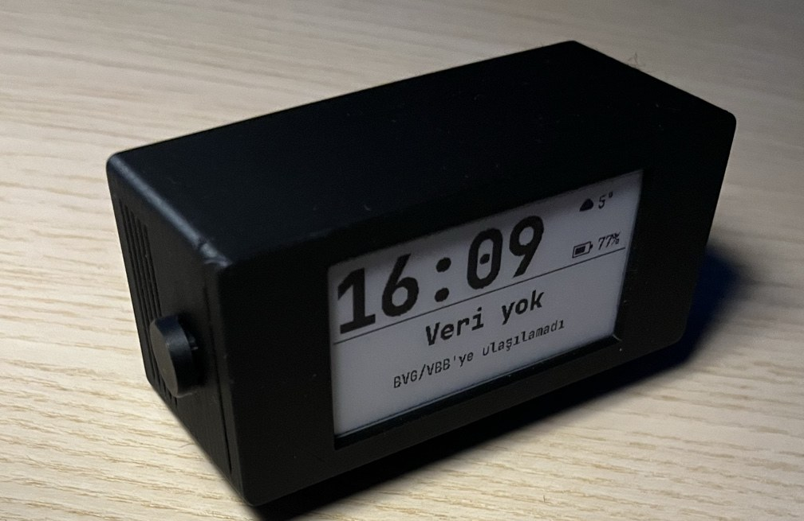
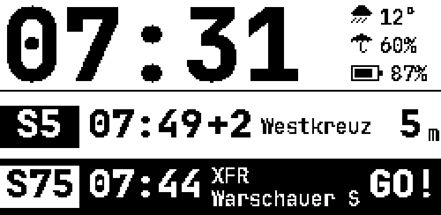
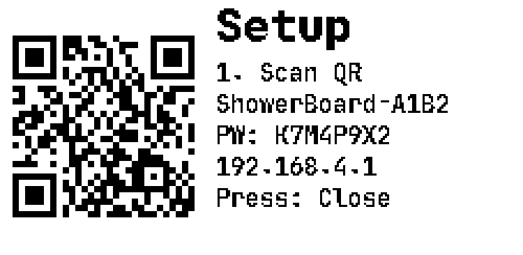
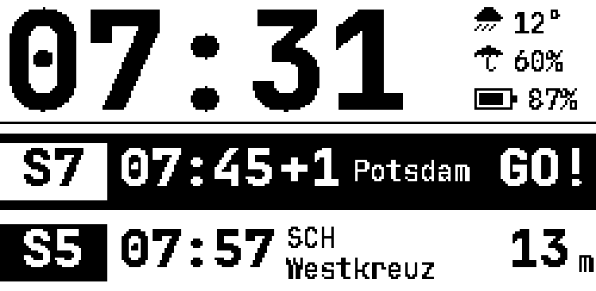
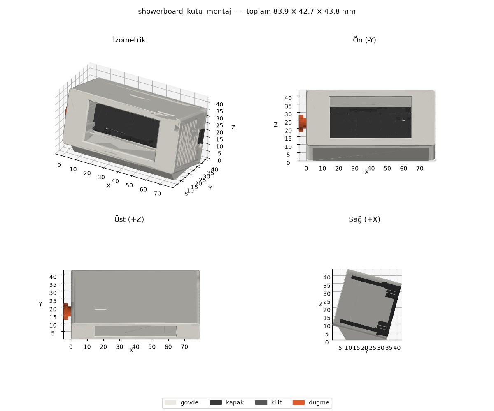

<p align="center">
  
</p>

<h1 align="center">Showerboard</h1>

<p align="center">
  <strong>Battery-powered e-Paper clock, weather, and live Berlin transit countdown display — with one-button WPA2 QR setup, EN/DE/TR web portal, and a screwless 3D-printable enclosure.</strong>
</p>

Built on a **Raspberry Pi Pico W** and a **Waveshare Pico-ePaper-2.13** display, Showerboard tells you the time, rain chance, battery level, and exactly how many minutes remain before you need to leave for your next S-Bahn, U-Bahn, tram, or bus — factoring in live delays, walking time, and shower/prep time. No cloud account, no mobile app, and no editing config files after flashing: press the side button, scan the QR code on screen, and configure Wi-Fi, language (`EN` / `DE` / `TR`), stop, and sleep schedule from your phone.

---

## At a Glance



| 1. Live Departures (`EN` / `DE` / `TR`) | 2. One-Button WPA2 QR Setup (`Setup`) |
| :---: | :---: |
|  |  |
| Clock largest, weather & battery top-right, next two departures with live delay and floor-rounded leave countdown | Press the side button → scan QR to join the ephemeral WPA2 AP (`192.168.4.1`) → press again or save to return |

| 3. Urgent Alert (`GO!` / `ÇIK!` / `LOS!`) | 4. Screwless 3D-Printable Enclosure (`v10`) |
| :---: | :---: |
|  |  |
| High-contrast inverted bar when under 2 minutes remain to leave | 4 support-free parts (83.9 × 42.7 × 43.8 mm, 15° tilt), ready-to-slice STL & STEP included |

---

## Install & Build with an AI Agent (Recommended)

Paste this prompt into **Claude Code**, **Antigravity**, **Gemini CLI**, **Codex**, or **Cursor**:

```text
Clone https://github.com/mskasal/showerboard, read SETUP.md, ask me about my
e-Paper panel revision and power setup before flashing or changing anything,
then deploy to my Pico W and verify with the unit tests and desktop preview.
```

The agent will ask a few short questions (e-Paper panel `V3` / `V4` / `V4B`, USB vs. LiPo battery, whether you need the 3D-printable enclosure), deploy the firmware, and guide you through the QR setup.

Prefer manual installation? See [SETUP.md](SETUP.md) or the quickstart below.

---

## What Showerboard Is — and What It Is Not

**Showerboard is:**
- A **calm, zero-distraction morning display** that prioritizes the clock, then your exact leave-by countdown, then weather and battery.
- **Honest about accuracy**: countdowns are floored so the screen never overstates remaining time; cancelled trips are skipped; stale or unreachable feeds never show outdated numbers (`Stale data` / `No data`).
- **One-button, zero-menu UX**: press once to open the local QR setup portal (switch between **English**, **German**, and **Turkish** right in the browser); press again or tap **Save & Start** to return to normal operation.
- **Local-first & hardened**: talks directly to public [transport.rest](https://v6.bvg.transport.rest) (BVG/VBB) and [Open-Meteo](https://open-meteo.com) endpoints — no API keys, no companion server, no account. Setup AP uses a fresh per-session WPA2 password embedded in the QR code, with CSRF, Host/DNS-rebinding, and strict input validation on the local portal.
- **Complete open-source hardware + firmware**: MicroPython firmware, 78 CPython unit tests, desktop PNG previewer, parametric Build123d CAD ([designed with Forge](https://github.com/mskasal/forge)), and ready-to-slice `.stl` / `.step` files.

**Showerboard is NOT:**
- **Not city-agnostic out of the box:** transit lookup and departures use the Berlin/Brandenburg BVG & VBB (`transport.rest`) APIs and Europe/Berlin DST rules (`CET`/`CEST`). Other cities require adding a provider adapter in `transit.py` and timezone rules in `timeutil.py` (see [CONTRIBUTING.md](CONTRIBUTING.md)).
- **Not waterproof / submersible:** the 3D-printed PLA/PETG enclosure has a side USB-C slot and button cutout — place or mount it outside direct shower spray (e.g. bathroom shelf or outer glass).

---

## Components & Guides

| Component | What it includes | Guide |
| --- | --- | --- |
| **MicroPython Firmware (`firmware/`)** | State machine (`main.py`), `EN`/`DE`/`TR` localization (`i18n.py`), BVG/VBB client (`transit.py`), Open-Meteo (`weather.py`), NTP + Berlin DST (`timeutil.py`), VSYS battery reader (`battery.py`), unified V3/V4/V4B driver (`epd_2in13.py`) | [SETUP.md](SETUP.md) |
| **WPA2 QR & Captive Portal (`firmware/`)** | Ephemeral WPA2 Wi-Fi AP + DNS captive portal (`portal.py`, `portal.html`, `qr.py`), `EN`/`DE`/`TR` live switcher, address-to-nearby-stops lookup, atomic `config.json` (`config_store.py`), automatic LAN fallback on low RAM | [SETUP.md](SETUP.md#4-configure-on-device-qr--captive-portal) |
| **Hardware & 3D Enclosure (`hardware/`)** | Full BOM (~€25–30), pinout & wiring, LiPo + TP4056 + GP15 button setup, screwless 4-part support-free enclosure (`enclosure.py` + ready-to-print `.stl` / `.step`) | [hardware/README.md](hardware/README.md) |
| **Desktop Preview & Tests (`tools/`, `tests/`)** | Off-device PNG screen renderer (`firmware/display.py`) and 78 CPython unit tests covering DST transitions, countdown math, button debounce, QR encoding, glyph coverage, and portal security | [SETUP.md](SETUP.md#desktop-preview--tests) |

---

## Architecture & Power Design

```text
Raspberry Pi Pico W (MicroPython ≥ v1.22)
┌─────────────────────────────────────────────────────────────────────────┐
│ Boot → Hardware self-check (display, battery, Wi-Fi, NTP, BVG, weather) │
│   │                                                                     │
│   ├─ First boot / side button press (or hold 2.5s at boot)              │
│   │    └─▶ SETUP MODE: Ephemeral WPA2 AP + QR + DNS Captive Portal      │
│   │                    (192.168.4.1 → atomic config.json, LAN fallback) │
│   │                    Press button again or Save to return to Active   │
│   │                                                                     │
│   ├─ Active window (or 24/7 when sleep is off)                          │
│   │    └─▶ ACTIVE MODE: WDT (8s), instant button listener (GP15), Wi-Fi │
│   │                     wakes only to fetch BVG / Open-Meteo / NTP,     │
│   │                     then shuts down before VSYS battery read        │
│   │                                                                     │
│   └─ Outside active window                                              │
│        └─▶ SLEEP MODE: Sleep screen → CYW43 power_down() → 2.5s settle  │
│                        → machine.deepsleep() in ≤ 1800s slices          │
└─────────────────────────────────────────────────────────────────────────┘
```

### Countdown Accuracy Rules
- **Leave-by formula:** `remaining = departure (incl. live delay) − now − WALK_MIN − PREP_MIN`.
- **Floor rounding:** the displayed minute is floored until the next refresh slot — if the screen reads `5 m` / `5 dk`, you have at least 5 full minutes until the next update.
- **Missed vs. urgent:** fewer than `WALK_MIN` until departure shows `LATE` / `GEÇ` / `SPÄT` (paired with the next catchable train below); less than `PREP_MIN` left but still walkable shows inverted `GO!` / `ÇIK!` / `LOS!`.
- **Line priority:** the first row prefers the earliest catchable line in `DIRECT_LINES` (e.g. `S5`, `S7`); transfer lines (`XFR` / `AKT.` / `UMST`) appear in the second row only when they depart earlier.
- **No stale lies:** cancelled departures are dropped; feeds older than `MAX_DATA_AGE_S` / `MAX_REALTIME_AGE_S` replace the countdown with `Stale data`; network failures show `No data` or `No Wi-Fi`.

### Single-Button Controls (`GP15` ↔ `GND`)

| Action | Behavior |
| --- | --- |
| **Press (in Active mode)** | Opens QR Setup Portal immediately |
| **Press (in Setup / QR mode)** | Closes Setup Portal and returns to normal operation |
| **Press (in Sleep mode)** | Wakes the device for `MANUAL_WAKE_MIN` (default 30 min) |
| **Hold 2.5 s at boot** | Boots directly into QR Setup Portal |
| **Hold 9 s** | Factory reset (erases `config.json` & `state.json`, reboots to Setup) |

---

## Manual Quickstart

Requirements: Raspberry Pi Pico W + Waveshare Pico-ePaper-2.13 (`V3`, `V4`, or `V4B`), Python 3.9+ on your computer, `mpremote`.

1. Flash the latest stable **MicroPython `.uf2`** (≥ v1.22) for `RPI_PICO_W` from [micropython.org](https://micropython.org/download/RPI_PICO_W/) while holding **BOOTSEL**.
2. Clone and deploy to the connected Pico W:
   ```bash
   git clone https://github.com/mskasal/showerboard.git && cd showerboard
   pip install mpremote
   sh tools/deploy.sh
   mpremote reset
   ```
3. On first boot (or anytime you press the side button), the e-Paper displays a **WPA2 Wi-Fi QR code** (`ShowerBoard-XXXX` + per-session password). Scan it with your phone to join, open `http://192.168.4.1/` (or wait for the captive portal popup), pick your language (`EN` / `DE` / `TR`), Wi-Fi, Berlin address, stop, walking time, and sleep schedule, then tap **Save & Start**.

Preview screens and run tests on your computer without hardware:

```bash
pip install pillow
python3 firmware/display.py            # generates preview/*.png
python3 -m unittest discover -s tests  # runs all 78 unit tests
```

---

## Multi-Agent Support

- Repository-level instructions for AI coding agents live in [AGENTS.md](AGENTS.md) (with pointers in [CLAUDE.md](CLAUDE.md) and [GEMINI.md](GEMINI.md)).
- The 3D enclosure in [hardware/enclosure/enclosure.py](hardware/enclosure/enclosure.py) was designed parametrically with [Forge](https://github.com/mskasal/forge) (`build123d`) using caliper-measured component dimensions.

---

## License & Third-Party Credits

Showerboard (firmware, captive portal, and 3D enclosure CAD/exports) is licensed under **GNU AGPL-3.0** (see [LICENSE](LICENSE)). See [CONTRIBUTING.md](CONTRIBUTING.md) for contributor license details.

Third-party components & data:
- `firmware/epd_2in13.py`: adapted from Waveshare's [Pico_ePaper_Code](https://github.com/waveshare/Pico_ePaper_Code) (MIT-style permission notice preserved in the file header).
- `firmware/fonts/*.bin`: bitmap fonts generated from [JetBrains Mono](https://github.com/JetBrains/JetBrainsMono) under the SIL Open Font License 1.1 (`tools/make_fonts.py`).
- Live transit & weather data: [transport.rest](https://v6.bvg.transport.rest) (BVG/VBB HAFAS) and [Open-Meteo](https://open-meteo.com).
