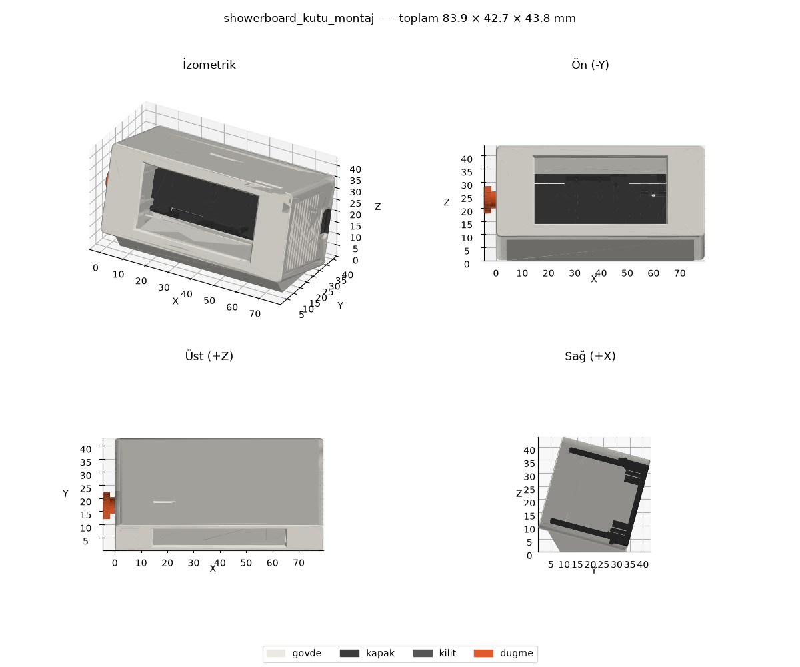
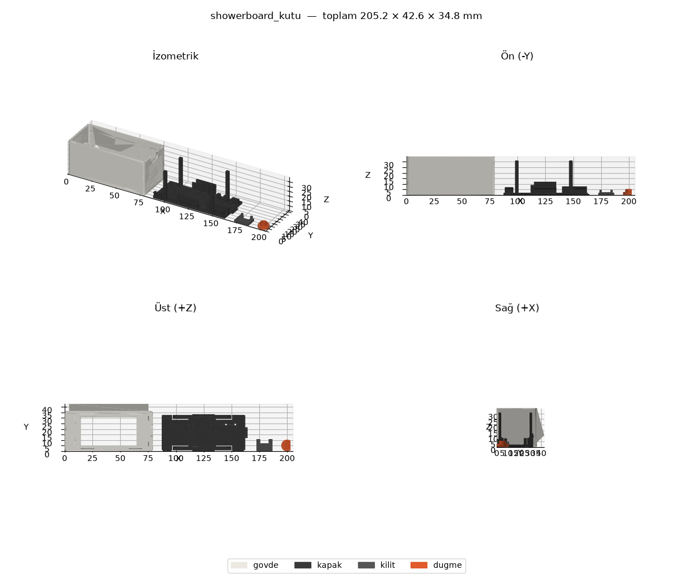

# Showerboard Hardware & 3D Enclosure

Complete bill of materials, wiring guide, and screwless 3D-printable enclosure (`v10`, `desk` style) for Showerboard.



---

## Bill of Materials (BOM)

Total estimated parts cost: **~€25–30**.

| Part | Exact / Tested Model | Key Measured Dimensions | Qty | Notes |
| --- | --- | --- | --- | --- |
| Microcontroller | **Raspberry Pi Pico W** (with male headers) | 51.0 × 21.0 mm | 1 | 2.4 GHz Wi-Fi; plugs straight into e-Paper female header |
| e-Paper Display | **Waveshare Pico-ePaper-2.13** (`V3`, `V4`, or `2.13-B V4`) | PCB 65.11 × 30.49 mm (66.12 mm incl. FPC bend) | 1 | `V3`/`V4` (B/W) supports fast partial refresh; `V4B` (R/B/W) works with ~17 s full refresh |
| Battery | **MakerFocus 1000 mAh 3.7 V LiPo** (or similar 3.7 V LiPo) | 42.1 × 25.0 × 10.44 mm | 1 | Fits the ribbed battery tray on the back cover with 1.9 mm clearance to the Pico |
| Charger Module | **HW-373 (TP4056) USB-C LiPo Charger** with protection | PCB 27.93 × 17.12 × 0.98 mm (4.17 mm incl. USB-C) | 1 | Slides into back-cover rails; status LEDs shine through 2 holes in the rear dot grid |
| Tactile Button | **12 × 12 × 7.3 mm** square-stem tactile switch | Body 12.0 × 12.0 × 4.3 mm, 4×4 mm yellow stem | 1 | Mounted on left wall, retained screwlessly by `button_lock`, topped by `button_cap` |
| Schottky Diode *(optional)* | e.g. 1N5819 / SS14 | — | 1 | Recommended between charger `OUT+` and Pico `VSYS` if USB and battery may be connected together |
| Hookup Wire | 26–28 AWG silicone wire | — | ~20 cm | For button (`GP15`–`GND`) and charger (`OUT+`/`OUT-` → `VSYS`/`GND`) |

> **Using a different LiPo size?** Edit `BATT_L`, `BATT_W`, `BATT_T` in [enclosure/enclosure.py](enclosure/enclosure.py) and re-export with Build123d / Forge.

---

## Wiring & Pinout

### 1. Display (Direct Plug-In)
Seat the Pico W directly onto the Waveshare Pico-ePaper-2.13 female headers (align USB port with the silkscreen outline). Pins used by `epd_2in13.py`:

| Signal | Pico W Pin |
| --- | --- |
| `SCK` (SPI1) | `GP10` |
| `MOSI` (SPI1) | `GP11` |
| `CS` | `GP9` |
| `DC` | `GP8` |
| `RST` | `GP12` |
| `BUSY` | `GP13` |

### 2. Tactile Button (`GP15` ↔ `GND`)
Solder two flexible wires from opposite legs of the 12×12 tactile switch to:
- **`GP15`** (physical pin 20) — configured with internal `PULL_UP` (active-low).
- **`GND`** (e.g. physical pin 18 or 23).

*(Optional alternative for hard wake from deep sleep: wiring a reset switch between **RUN (pin 30)** and **GND** reboots the Pico cleanly and triggers `MANUAL_WAKE_MIN` active time.)*

### 3. LiPo Battery & TP4056 Charger (`VSYS` / `GND`)
1. Connect the LiPo battery leads to **`B+`** and **`B-`** on the HW-373 (TP4056) charger board (observe polarity!).
2. Connect charger **`OUT+`** → Pico **`VSYS` (pin 39)** (ideally through a Schottky diode, cathode toward `VSYS`) and charger **`OUT-`** → Pico **`GND` (pin 38)**.
3. If you add a Schottky diode, set `VSYS_DIODE_DROP_V = 0.25` (or your diode's measured drop) in `config.py` so the battery percentage stays accurate.

**Battery sensing note:** Pico W measures `VSYS` on `GPIO29` (`ADC3`), which is shared with the CYW43 Wi-Fi chip. `battery.py` always reads `VSYS` only while Wi-Fi is off and restores the pin state afterward. When `VSYS > 4.35 V`, the display shows `USB`.

---

## 3D-Printable Enclosure (`v10`, Desk Style)

Assembled outer size: **83.9 × 42.7 × 43.8 mm** with an integrated **15° backward tilt plinth** — no separate stand and **zero screws or supports** needed.



### Ready-to-Print Exports

Slice directly from [enclosure/exports/](enclosure/exports/):

| Part | STL (ready to slice) | STEP (CAD editable) | Print Orientation (Z=0 on bed) | Role |
| --- | --- | --- | --- | --- |
| **Body** (`govde`) | [body.stl](enclosure/exports/body.stl) | [body.step](enclosure/exports/body.step) | Front bezel face-down | Ribbed main shell, 15° plinth, beveled display window, left button pocket, right USB-C cutout |
| **Back Cover** (`kapak`) | [back_cover.stl](enclosure/exports/back_cover.stl) | [back_cover.step](enclosure/exports/back_cover.step) | Outer dot-grid face-down | Snaps shut via 3 bottom hooks + top clip; holds LiPo tray, HW-373 rails, 2 charge-LED holes, and 4 sprung posts pressing the e-Paper forward |
| **Button Lock** (`kilit`) | [button_lock.stl](enclosure/exports/button_lock.stl) | [button_lock.step](enclosure/exports/button_lock.step) | Flat back face-down | U-notched slide-in retainer locking the 12×12 switch behind the left wall with zero vertical play |
| **Button Cap** (`dugme`) | [button_cap.stl](enclosure/exports/button_cap.stl) | [button_cap.step](enclosure/exports/button_cap.step) | Outer cap face-down | Accent cap (`Ø10.4 mm`, press-fit `3.95 × 3.95 mm` square socket with lead-in chamfer for the 4×4 mm stem) |

### Recommended Slicer Settings
- **Nozzle / Layer height:** `0.4 mm` nozzle, `0.20 mm` layer height (tested on Bambu Lab A1).
- **Supports:** **None** — every overhang uses chamfers or teardrop holes (`Ø8.0 mm` button opening).
- **Filament:** PLA Matte or PETG (PETG recommended if placed in a very warm/steamy bathroom). Print `button_cap` in a contrasting accent color (e.g. terracotta/orange).
- **Tolerance test coupons:** Before printing the full shell on a new printer/filament, you can optionally print the small fit coupons in [enclosure/test_coupons/](enclosure/test_coupons/) (`btn_test.py` for button/cap press-fit, `usbc_test.py` for HW-373 slide rails).

### Assembly Order (Screwless)
1. **Button:** Insert the wired 12×12 tactile switch into the left-wall pocket from inside the body (yellow stem protruding through the left wall), then slide `button_lock` down the vertical grooves behind it. Press `button_cap` onto the 4×4 mm stem from the outside.
2. **Display stack:** Drop the assembled Pico W + Waveshare e-Paper stack face-down into the body so the glass centers in the beveled window against the internal stops.
3. **Battery & charger on back cover:** Slide the HW-373 (TP4056) into the rear-cover rails until it hits the front stop (USB-C facing right, LEDs aligned with the two open holes in the rear dot grid), and seat the 1000 mAh LiPo into the ribbed battery tray.
4. **Close:** Tuck the wires cleanly between the battery and Pico, hook the 3 bottom tabs of `back_cover` into the body first, then tilt and press the top edge until the top snap clicks shut.

### Regenerating CAD from Source
The parametric model lives in [enclosure/enclosure.py](enclosure/enclosure.py) and uses [Build123d](https://github.com/gumyr/build123d) + [Forge](https://github.com/mskasal/forge):

```bash
forge run hardware/enclosure/enclosure.py
```

Every real-component dimension in `enclosure.py` is commented with its caliper measurement date or datasheet source.
